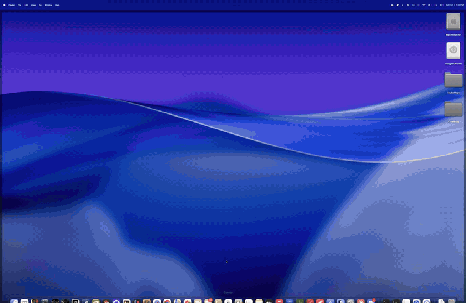
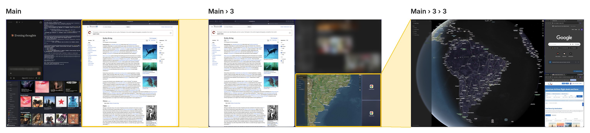

# Scuba

Scuba is a menu bar app for macOS that arranges your windows into pools.
Any pool can hold a whole layout of its own, so you can zoom into a pool to
work at full size and zoom back out to see everything at once.



**[⬇ Download the latest version](../../releases/latest)** · Apple silicon Macs, macOS 14 or newer

> **Beta (0.8).** Ready for testing: expect a few rough edges. Saved pools and live portholes
> are **BETA** within the beta. Feedback and bug reports are welcome on the
> [Issues page](../../issues).

## What it does

- **Caps Lock is your Scuba key.** Hold it for Scuba's shortcuts; a quick
  tap is still normal Caps Lock, and the light only comes on for a tap.
- **The Desktop.** A fresh start is all Desktop, where windows float like on
  a normal Mac: nothing moves until you dock one. Drag a window to a screen
  edge and it docks there, and the Desktop makes room.
- **The same at every level.** Diving goes one level at a time toward the
  pointer, into a group of tiles or a tile, and back out with nothing
  changed. Breathing room is a little Desktop you can dive into. Tiles split
  to stay screen-shaped, and boards too small to see show as miniatures.
- **Smooth and patient.** Drags wait a beat on each spot, then pictures of
  the windows glide there; windows have fine outlines, and frost over only
  when they're too small to use. Cmd + Shift + drag a box to zoom in on that
  part; double-click a title bar or the Desktop to zoom in on it.
- **Snapping.** Caps Lock + ← / → snaps the window you're using to a half, then
  Caps Lock + ↑ / ↓ makes it a quarter, the way Windows does it.
- **Locks.** Caps Lock + P locks a board's placements; Caps Lock + L locks one
  window in place. Windows you open on a locked board float on top and
  stay with it until you punch one in (Caps Lock + P on that window).
- **Every window its own tile.** Drag a window onto another and it docks
  beside it, each with a space of its own. Pull it away and the space closes
  up. You see where everything will go before you let go.
- **Pools.** Each board is split into pools, and each pool holds one or
  more windows, filling it or floating inside it. Drag a window onto a pool,
  or cut and paste it there (Caps Lock + X, Caps Lock + V), tabs and all.
- **Pools inside pools.** Any pool can hold a board of its own. Zoom in to
  work at full size, zoom out to see everything in miniature. The menu bar
  shows where you are, like `Main › 3 › 3`.
- **Zooming with the trackpad.** Swipe down with three fingers to zoom into
  the pool under the pointer, up to zoom out, sideways to move to the next
  board.
- **Your desktop stays as it is.** Scuba only arranges windows once you go
  in (Caps Lock + ↑). Caps Lock + Esc puts your normal desktop back.
- **Portholes.** On a nested board, a window too big for its pool shows as
  a picture of itself instead of spilling over its neighbours.
- **A coach for your first swim.** A small card walks you through the
  basics one step at a time, ticking each off as you do it.
- **Breathing room, hiding, saved views, spotlight** and more. See the
  [user guide](docs/USER_GUIDE.md), or **Quick guide…** at the top of
  Scuba's menu.
- **Saved pools (BETA).** Save a pool with its apps and layout, close it,
  and open it again later. Browser tabs come back too.



## Install

You need a Mac with Apple silicon (M1 or newer) on macOS 14 or newer.

1. Download **Scuba Test Build.zip** from the [latest release](../../releases/latest).
2. Unzip it, drag Scuba into Applications, and open it.
3. macOS will block the first launch because the app isn't from the App
   Store. Click **Done**, then go to **System Settings › Privacy & Security**
   and click **Open Anyway**.
4. In the Setup window, turn on **Accessibility** (required) and **Screen
   Recording** (optional, for animations and portholes).

The zip includes a **Start Here.txt** with the same steps and the basic
moves. The [user guide](docs/USER_GUIDE.md) covers everything else.

## Build from source

You need Xcode or the Xcode Command Line Tools.

```
git clone https://github.com/Canobiir/Scuba.git
cd Scuba
./build.sh
open build/Scuba.app
```

- `dev/setup-signing.sh` (run once) creates a local signing certificate,
  so macOS keeps Scuba's permissions across rebuilds.
- `./build.sh --share` also makes **Scuba Test Build.zip** on your Desktop,
  ready to attach to a release or send to someone.

## Documentation

- [User guide](docs/USER_GUIDE.md): installing, the main ideas, and how to
  use every feature, with screenshots
- [Feature reference](docs/REFERENCE.md): detailed notes on each feature
  and setting

## License

All rights reserved: free to download and use, but the code isn't open
source. Versions 0.7 and earlier were released under MIT. See [LICENSE](LICENSE).
